# Attempts Design

## Entities and lifecycle

```mermaid
stateDiagram-v2
  [*] --> SCHEDULED: enrollment trigger / lecturer schedules
  SCHEDULED --> IN_PROGRESS: interview start; first question in same transaction
  IN_PROGRESS --> COMPLETED: interview completes or existing deadline closes it
  IN_PROGRESS --> ABANDONED: explicit abandon / stale active-session recovery
  SCHEDULED --> EXPIRED: scheduled window passes before start
  SCHEDULED --> CANCELLED: lecturer removes unused slot
  IN_PROGRESS --> VOIDED: authorized lecturer/admin records incident reason
  COMPLETED --> VOIDED: authorized lecturer/admin before release
  VOIDED --> [*]: retained for audit, excluded from attempt count and score policy
  COMPLETED --> SCHEDULED: another allowed attempt is allocated
```



`student_session_assignment` remains one enrollment row per student/exam and mirrors attempt 1 schedule/aggregate status for legacy clients. `exam_attempts` has independent attempt number, schedule, counted flag, status and interview-session ID. `viva_attempt.exam_attempt_id` and `grading_submissions.exam_attempt_id` uniquely point to the same row. Existing interview turns, audio references, STT, Group 4 AI runs and lecturer revisions remain linked to their original `viva_attempt` and are never copied between attempts.

## Start/first-question transaction

```mermaid
sequenceDiagram
  participant FE as Student FE
  participant BE as InterviewService
  participant DB as PostgreSQL
  FE->>BE: POST /api/interviews/start {examAttemptId}
  BE->>DB: lock enrollment row; verify owner/enrollment/session/status
  BE->>DB: count counted non-void attempts; check active slot, time window and cooldown
  BE->>DB: find or create the VivaAttempt for exam_attempt_id
  BE->>DB: insert first MAIN interaction_turn
  BE->>DB: mark exam_attempt counted=true, IN_PROGRESS; append audit hash event
  BE-->>FE: InterviewResponse with attemptNo and first question
```

The write transaction rolls back the counted flag and interview if no first question can be created. Reconnect requests with the same examAttemptId resume the same viva attempt. Device-check endpoints do not touch `exam_attempts`.

## Eligibility and allowance

The service verifies the enrollment is active, exam status is open, the requested attempt belongs to the student/enrollment, counted non-void attempts are below `max_attempts + extra_attempts`, there is no other SCHEDULED/IN_PROGRESS attempt, schedule/global window is open, and cooldown has elapsed. Enrollment row locking serializes start against grant/revoke and competing tabs. A unique `(exam_id, student_id, attempt_no)` is the database backstop.

Completion allocates the next SCHEDULED attempt when the allowance permits. Abandonment uses the `count_abandoned` setting (default true) only if the first question had been counted. A scheduled expiry uses `count_expired` (default false). Voiding always clears counted and retains the record. Unused slots above a lowered limit are cancelled; used attempts remain unchanged and each affected student is returned in `affectedStudents`.

## Official result

Only finalized Group 4 lecturer scores participate; AI suggestions never select a result. `LATEST`, `FIRST`, and `HIGHEST` set `official_attempt_id`; `AVERAGE` stores `computed_total` and no pointer; `LECTURER_CHOOSES` clears any system-derived selection and waits for a confirmed lecturer call. Recompute runs after finalize, reopen, void and settings change. `released` remains false until the relevant Group 4 grade(s) are released; AVERAGE waits until all contributing finalized grades are released. Student APIs redact AI suggestions and unreleased final scores.
