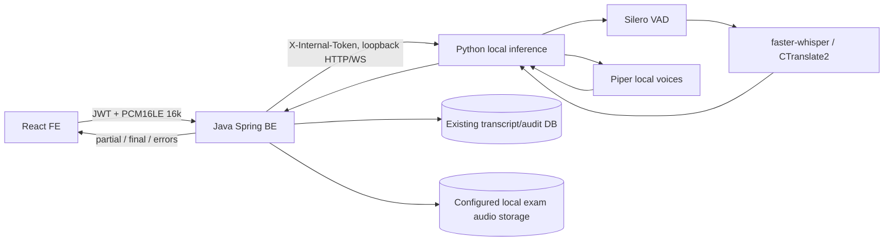

# Local Speech Architecture

## Normal turn

BE authenticates student, validates purpose and explicit consent. For `streaming_only`/`dual`, BE opens an internal local WS and streams FE PCM frames. Inference VAD frames speech segments, performs periodic bounded partial decode, sends stable LocalAgreement prefixes, and finalizes a VAD segment on silence or BE commit. FE protocol is unchanged. On end, `streaming_only` uses committed segments; `final_only` batch decodes the ring buffer; `dual` final-decodes then reconciles and uses the accepted final transcript. Existing analyzer is retained only to route an optional follow-up question; it does not return scores or rubric analysis. Lecturer remains responsible for final grading.

When a next question/follow-up is prepared, Piper prewarm/cache can run during the current turn. The FE currently uses the existing authenticated question-audio route; chunked output is carried as WAV bytes using `StreamingResponseBody` and the current player contract.

## Local socket interruption

The Java PCM ring buffer retains a bounded window. Commit offsets advance on local `committed` events. A disconnect triggers up to three jittered reconnect attempts and replays only retained uncommitted PCM from the last committed offset. Replay buffer overflow produces `LOCAL_REPLAY_WINDOW_EXCEEDED`; exhausted reconnect produces a typed error. On EXAM error the configured retained audio can be re-transcribed using the existing local batch endpoint.

## Overload / fallback

Inference has a bounded semaphore queue. It returns 429 + Retry-After rather than accumulating partial work. `dual` mode can still use final if stream failed while buffered audio remains; `streaming_only` relies on already committed text. Resource counters record audio-seconds, queue/inference duration, partial/commit counts and errors, without transcript/audio identifiers. Piper has an in-memory WAV cache; runtime failure exposes explicit TTS not-ready/error rather than synthesizing mock speech in production.
