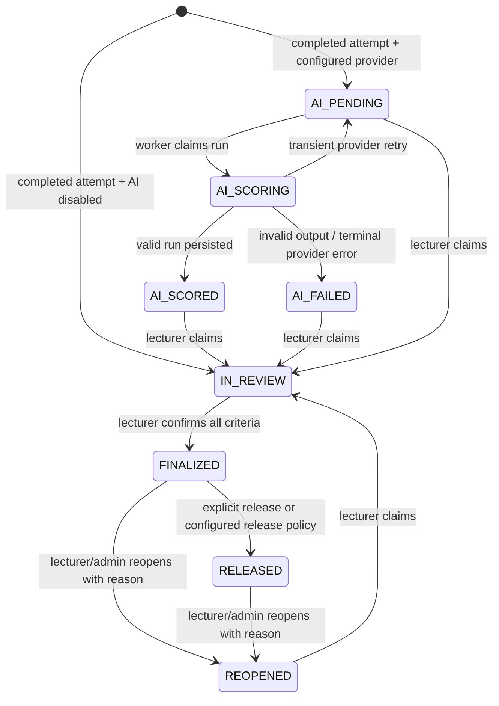

# Group 4 Grading Design

## State flow

The Java transition table and database status/actor constraints are independent guards. AI code writes only `ai_*` fields and the legacy AI projection `final_grade_report.total_ai_score`. Only the lecturer finalize service writes `final_teacher_score`, `finalized_by_lecturer_id`, and `finalized_at`; PostgreSQL checks require all three together and require an LE/AD actor.

## Scoring

The AI returns a bounded fraction for each criterion plus a rationale and transcript quote. Java verifies JSON shape, aliases, range and exact evidence substring. For K samples it stores each fraction, uses the median as the suggestion, calculates population variance, multiplies by criterion weight and divides the criterion maximum across the number of main questions. Final totals are recomputed from lecturer criterion scores in Java `BigDecimal`, normalized to the configured 10-point scale and rounded by the configured step. The AI never returns a total that the backend trusts.

Low-STT-confidence/review signals are stored/displayed and become review flags after generation. They are not included in the prompt or score formula. `INCLUDE_SIGNALS_IN_GRADING=true` is rejected at startup; the current release does not implement scoring from these signals.

## Failure and privacy

PostgreSQL `FOR UPDATE SKIP LOCKED` leases one pending run. Expired running leases can be reclaimed. Provider errors retry at bounded exponential delays; malformed model output becomes a terminal failed run. AI assessment/evidence/feedback rows are append-only; run definition fields freeze at insert and completed run state cannot be changed. Logs contain run/submission IDs, provider, error class and code only. Transcript/audio content is not logged.

Student IDs are replaced with question/turn/criterion aliases. Email, phone-like strings and long digit sequences are redacted before LLM calls, but this is pattern-based and cannot guarantee removal of spoken names or every identifier. Local OpenAI-compatible inference is the default supported configured provider; remote endpoints require an explicit override and warning. No grading LLM is configured by default.
